# Kockás Füzet

<picture>
  <source media="(prefers-color-scheme: dark)" srcset="assets/banner-dark.svg">
  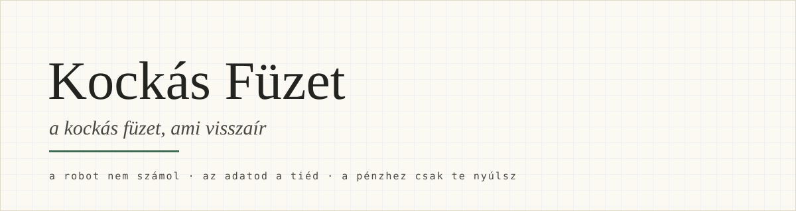
</picture>

Nyílt, ingyenes gyűjtemény, amivel a személyes és családi pénzügyeidet egy
AI-segéd segítségével tarthatod kézben — magyarul, ítélkezés nélkül, úgy,
hogy az adataid a tieid maradnak.

Nem app és nem szolgáltatás: receptek, táblázat-sablonok és egy lépésekben
felépíthető asszisztens-rendszer, amit a saját csevegődben (ChatGPT, Claude,
Gemini…) vagy a saját gépeden használsz.

> **Támogatás:** a teljes asszisztens-rendszer (skillek, parancsok,
> automatikus ellenőrzés) jelenleg **csak [Claude Code](https://claude.com/claude-code)-dal**
> működik. Az 1. lépcső bemásolós receptjei bármelyik AI-csevegőben
> használhatók.

## Három alapszabály

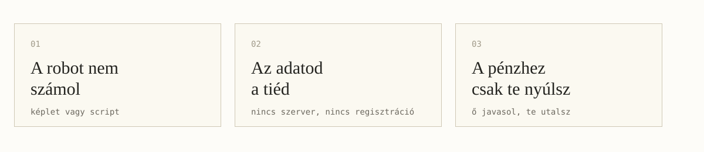

Minden, ami itt van, erre a három elvre épül:

1. **A számolást nem a robot végzi.** Minden összeg táblázat-képletből vagy
   ellenőrizhető, mindig ugyanúgy működő programból jön — a gép csak
   értelmez, kérdez és jelent. (A csevegő AI-k tudnak magabiztosan
   mellészámolni; ezért itt soha nem az ő fejszámolásuk a végeredmény.)
2. **Az adatod a tiéd.** A rendszer a te táblázatodban, a te gépeden, a te
   mappádban dolgozik. Nincs központi szerver, nincs regisztráció, és egy
   mozdulattal törölhetsz mindent.
3. **A pénzedhez csak te nyúlsz.** A segéd javasol, előkészít, kipipáltat —
   de nem utal, nem köt le, nem szerződik. És nem ítélkezik: ha kihagytál
   heteket vagy hónapokat, az nem hiba, hanem a normális élet. A győzelem
   az, hogy visszatértél.

## Miért bukik el a legtöbb próbálkozás?

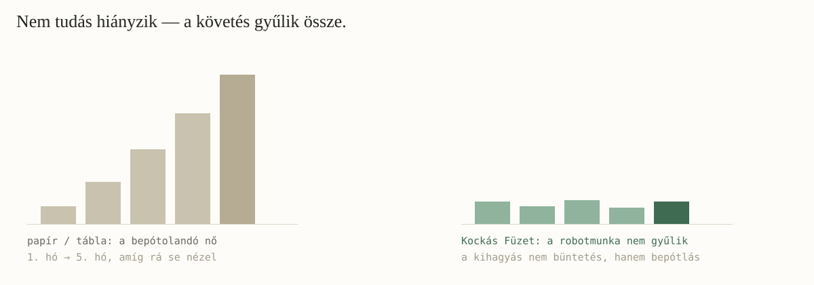

Nem tudás hiányzik. Kevesebbet költeni, mint amennyit keresel — ezt mindenki
tudja. A követés a munka: minden nap beírni, kategorizálni, hó végén
egyeztetni. Kimarad két hét, feltorlódik, már ránézni is rossz — és az egész
elhal. Ezért itt a monoton részt a gép viszi, a visszatérés pedig soha nem
büntetés.

## Hol szállj be? Három lépcső

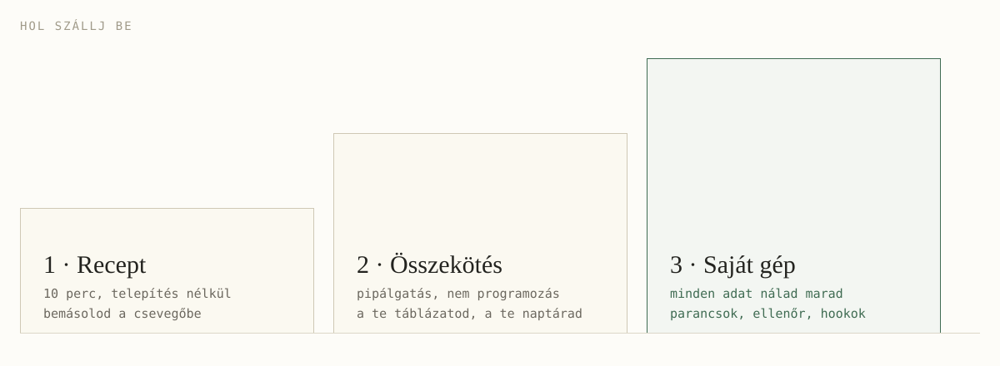

### 1. lépcső — 10 perc, telepítés nélkül

1. Tölts le egy havi kivonatot a netbankodból, és **töröld ki belőle a neved
   és a számlaszámokat**.
2. Nyisd meg a [`prompts/01-kivonat-elemzes.md`](prompts/01-kivonat-elemzes.md)
   receptet, másold be egy AI-csevegőbe a kivonatoddal együtt.
3. Nézd meg, mire jut — aztán jöhet a
   [`prompts/02-havi-terv.md`](prompts/02-havi-terv.md): havi terv,
   táblázatba illeszthető formában, ellenőrző képlettel.

Nincs kedved éles adattal próbálkozni? Használd a
[`examples/minta-kivonat.csv`](examples/minta-kivonat.csv) szintetikus
mintát — az ismert, helyes végeredményei a
[`examples/GROUND-TRUTH.md`](examples/GROUND-TRUTH.md) fájlban vannak,
így azt is látod, jól számolt-e.

### 2. lépcső — a segéd a TE táblázatoddal dolgozik

Ha a csevegődet összekötöd a Google Drive-oddal/naptáraddal (pipálgatós
engedélyezés, nem programozás), a [`.claude/skills/`](.claude/skills/) receptjei már a saját
családi kassza táblázatodban dolgoznak:

| Skill | Mit csinál |
|---|---|
| [`kivonat-konyvelo`](.claude/skills/kivonat-konyvelo/SKILL.md) | Kivonat → kassza, duplikátum-védelemmel, a kategóriákat tőled tanulja |
| [`havi-kor`](.claude/skills/havi-kor/SKILL.md) | Hónap eleji terv a saját számaidból + hónap végi zárás, ítélkezés nélkül |
| [`visszateres`](.claude/skills/visszateres/SKILL.md) | Kihagyott hetek-hónapok bepótlása gyorsan, szemrehányás nélkül |

A táblázat a főkönyv — és egyben az ellenőr. A kassza így néz ki, alul a
képlettel számolt sorral, amit a gép soha nem ír:

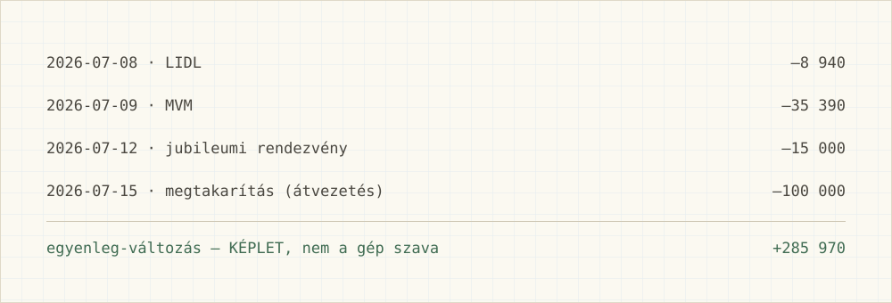

A táblázat-formátum és a beépített ellenőrző képletek leírása:
[`templates/csaladi-kassza-sablon.md`](templates/csaladi-kassza-sablon.md).

### 3. lépcső — a teljes rendszer a saját gépeden

Haladóknak (de nem programozóknak — itt is beszélgetsz): a
[Claude Code](https://claude.com/claude-code)-dal a teljes rendszer a
gépeden fut, egy `penzugy/` mappán:

- [`havizaras`](.claude/commands/havizaras.md) — egyetlen parancs, ami
  levezényli a teljes havi zárást;
- [`belefer`](.claude/commands/belefer.md) — vásárlás előtti gyors kép;
- [`penzugyi-ellenor`](.claude/agents/penzugyi-ellenor.md) — a beépített
  ellenőr, aki minden számot a determinisztikus
  [`scripts/ellenorzo.py`](scripts/ellenorzo.py)-val számoltat újra;
- [`.claude/hooks/`](.claude/hooks/) — automatikus ellenőrzés minden könyvelés után, hogy a
  verifikáció ne emlékezeten múljon.

Kipróbálás (kell hozzá: [Claude Code](https://claude.com/claude-code) és Python 3.11+):

```bash
git clone https://github.com/gomboczmarton/kockas-fuzet
cd kockas-fuzet && claude
> /havizaras 2026-07     # először az examples/ minta-adatokkal próbálkozik
```

A skillek, parancsok és az automatikus ellenőrző hook a `.claude/` mappában
vannak — a klónozás után azonnal élnek, telepíteni nem kell semmit.

#### A terminál mint füzetlap

A felület két rétegben jön, és egyik sem számol: mindkettő a
[`scripts/fuzetallapot.py`](scripts/fuzetallapot.py) kimenetéből rajzol, az
pedig az `ellenorzo.py` számaiból.

1. **Stabil réteg** ([`.claude/settings.json`](.claude/settings.json)) — a
   prompt alatti státuszsor (`▦ Kockás Füzet · 2026-07 · ✓ ellenőrizve`),
   magyar pörgettyű-szavak és tippek. Minden Claude Code-ban működik, amint
   a mappát megbízhatónak jelölöd (az első indításkor kérdezi).
2. **Mod** ([`.claude/skills/kockas-felulet/`](.claude/skills/kockas-felulet/)) —
   a prompt fölötti füzetsor (az utolsó 12 hónap négyzetei, a döntést kérő
   kategóriák), a `/fuzetlap` panel szalagokkal (asztali appban SVG-ként),
   és egy nyugta minden könyvelés után. A mod a Claude Code korai hozzáférésű
   kiegészítő-rendszerén fut: ha nálad még nincs bekapcsolva, egyszerűen nem
   jelenik meg, és minden más ugyanúgy működik.

Hosszabb szünet után a felület nem mutat kihagyott hónapokat — csak annyit
mond: *jó, hogy itt vagy*.

#### Claude Code nélkül

A tudás hordozható: skill-csomag a Claude.ai-hoz, ChatGPT-hez és Geminihez,
valamint egy helyi MCP szerver a Claude Desktophoz, amely a havi lapot
szalagokkal rajzolja. Mit kapsz, hol van az adat, mi marad ki:
[`hordozhato/README.md`](hordozhato/README.md).

A felépítés állapota és a „kész" kritériumai: [`BUILD-ORDER.md`](BUILD-ORDER.md).

## Mit kapsz a hónap végén?

A havi zárás nem ítélet, hanem kép. A túllépés **sárga és kérdés** — sosem
piros és vád:

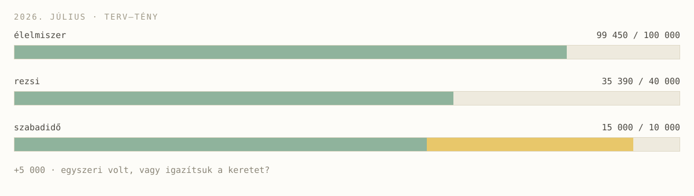

Minden szám alá odakerül, hogy honnan jött. Két állapot van, kettő elég:

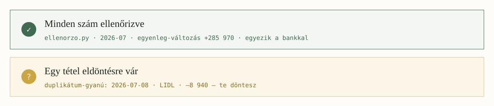

A riportot a rendszer egyetlen, offline HTML-fájlba írja — nincs benne külső
kérés, nyomtatható, és a dramaturgiája kötött (ami jól ment → eltérések →
legfeljebb két javaslat):

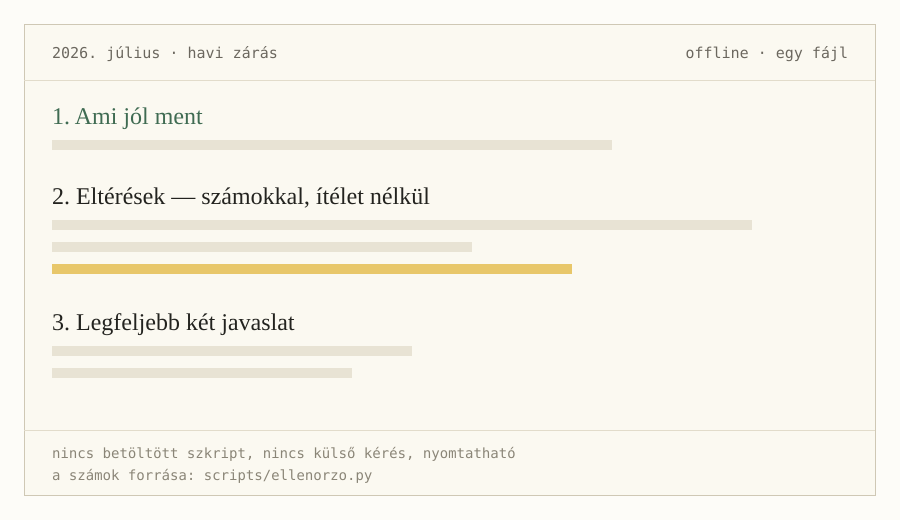

A sablon: [`templates/riport-sablon.html`](templates/riport-sablon.html).

## Vásárlás előtt: „belefér?"

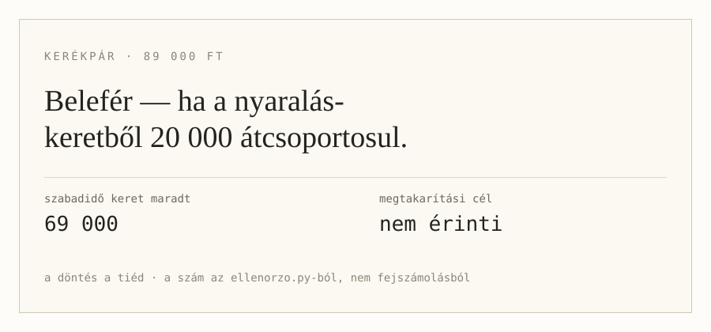

Harminc másodperc, tényszerű kép, ítélet nélküli opciók — és a döntés a tiéd.

## Kihagytál hónapokat? Az itt nem hiba

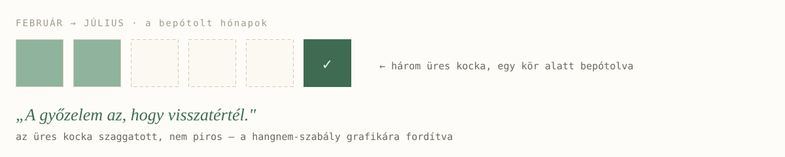

A [`visszateres`](.claude/skills/visszateres/SKILL.md) skill erre az egy mondatra
épül: **a győzelem az, hogy visszajöttél.** Nincs „megint", nincs „sajnos",
nincs lista a hátralékról — csak bepótlás, egy körben.

## Videók — nézd meg működés közben

Kilenc rövid terminál-videó mutatja a rendszert működés közben: vágatlan,
valódi munkamenetek, szintetikus mintaadatokkal, hétköznapi personák
szemével.

**▶ A teljes sorozat a YouTube-on: [Kockás Füzet — ami visszaír (lejátszási
lista)](https://www.youtube.com/playlist?list=PLcXziGNgfisQ)** — az első
videó a telepítést mutatja, klónozástól az első zöld tesztig:

[](https://youtu.be/xWI9hjcE8OI)

| # | Persona | Eset | Skill / parancs | Videó |
|---|---------|------|-----------------|-------|
| 1 | bárki | telepítés: klónozástól az első zöld tesztig | `git clone` + `bash evals/run.sh` | [▶](https://youtu.be/xWI9hjcE8OI) |
| 2 | Kata, 34 | bemásolós recept bármelyik AI-csevegőben | [`prompts/01`](prompts/01-kivonat-elemzes.md) + [`prompts/02`](prompts/02-havi-terv.md) | [▶](https://youtu.be/5O1Zu-_XRUA) |
| 3 | Gábor, 41 | új banki kivonat lekönyvelése, dedup + tanulás | `kivonat-konyvelo` skill | [▶](https://youtu.be/Kw6vG6kYpWQ) |
| 4 | Réka, 29 | belefér-e a 89 ezres kerékpár? | `/belefer` | [▶](https://youtu.be/pRHHjknqvzc) |
| 5 | Anna, 38 | teljes havi zárás, riporttal | `/havizaras` | [▶](https://youtu.be/njxDEUfezhI) |
| 6 | Bence, 33 | következő havi terv a saját számokból | `havi-kor` skill | [▶](https://youtu.be/kBSXCizUs9U) |
| 7 | Dóri, 36 | két kihagyott hónap bepótlása, szemrehányás nélkül | `visszateres` skill | [▶](https://youtu.be/PsBXVs3cRG4) |
| 8 | Péter, 45 | mire ment el a legtöbb? elfelejtett előfizetések | elemzés + `ellenorzo.py` | [▶](https://youtu.be/vHRjMtXgX9I) |
| 9 | Juli, 31 | készpénzes költés rögzítése menet közben | rögzítés + napló-szabály | [▶](https://youtu.be/IOrEgfLit98) |

Részletes esetleírások (use-case-enként):
[`docs/oktatas/videok-es-forgatokonyvek.md`](docs/oktatas/videok-es-forgatokonyvek.md).
A forgatókönyv-specifikációk (persona + elvárások): [`evals/scenarios/`](evals/scenarios/);
a lejátszó és a felvétel-készítő: [`demo/`](demo/).

## Oktatóanyag

- **[Oktató deck](docs/oktatas/oktato-deck.html)** — egyfájlos, offline
  bemutató (nyíllal lapozható, nyomtatható PDF-nek). Négy layoutból áll:

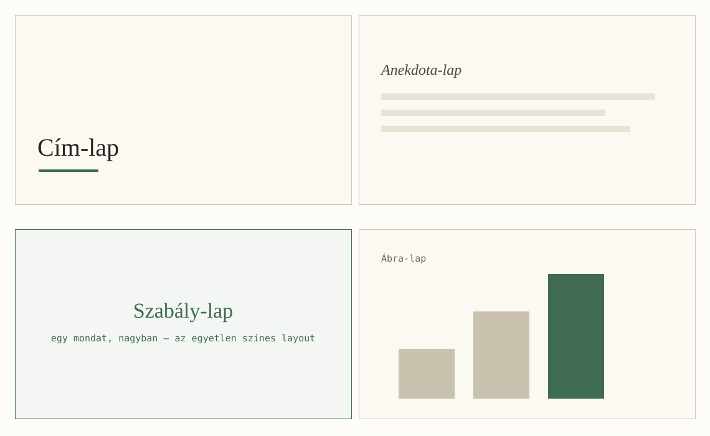

- **[DESIGN.md](docs/DESIGN.md)** — a vizuális nyelv: színek, betűk,
  hangnem-szabályok, és hogyan készül új ábra úgy, hogy passzoljon.
- Az `assets/` mappa minden ábrája szabadon felhasználható (MIT) — cikkhez,
  előadáshoz, saját fordításhoz.

## Testvérprojekt: Belay

Ugyanerre az alapra épül a [Belay](https://github.com/gomboczmarton/adhd-personal-finance-belay):
angol nyelvű pénzügyi társ ADHD-s felnőtteknek. Ugyanaz a három szabály, más
élethelyzet. Egy pillantásra, miben különböznek, és melyik kérdésre melyik
válaszol:

[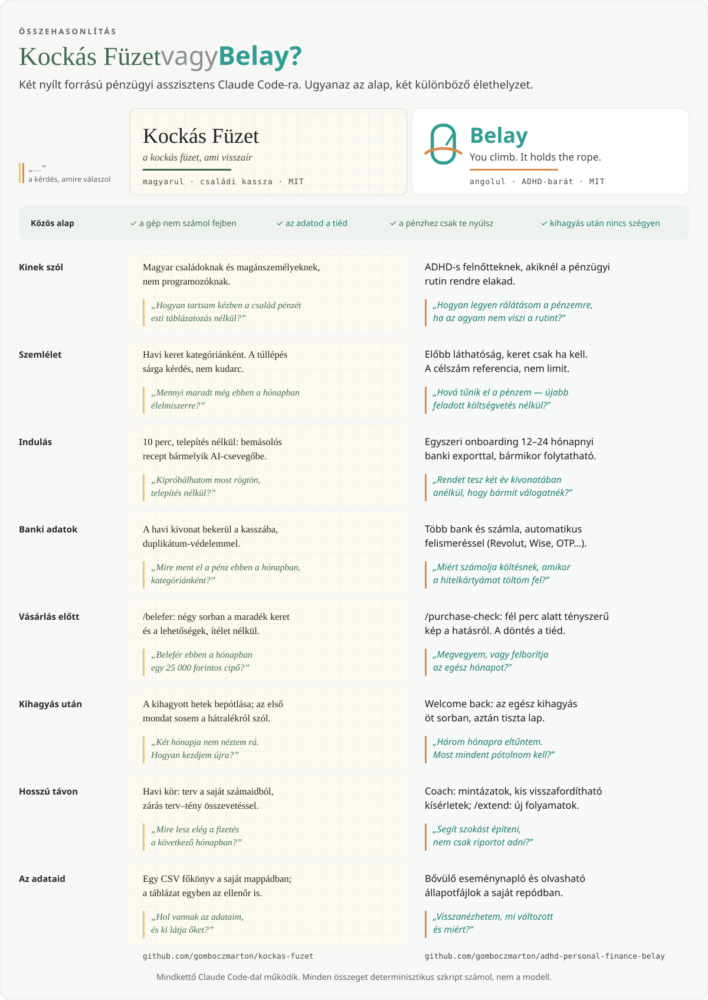](docs/osszehasonlitas.md)

Ugyanez szövegesen, táblázatban: [`docs/osszehasonlitas.md`](docs/osszehasonlitas.md).

## Miből lett ez?

A gyűjtemény egy kutatássorozatból nőtt ki: megnéztük, mire panaszkodnak az
emberek a pénzügyi appok kapcsán itthon és külföldön, és mibe bukik bele a
legtöbb próbálkozás. A válasz meglepően egységes: nem tudás hiányzik, hanem
a monoton követés fenntartása — a kimaradás utáni „hógolyó" és a rossz
érzés, ami miatt az ember inkább rá se néz. Ezért itt minden ennek a
kettőnek a megoldására épül: a robotmunkát a gép viszi, a visszatérés pedig
sosem büntetés.

## Szólj bele!

Kísérlet vagy, nem kész termék — pont ezért vagy itt jó helyen:

- **Kérdésed, ötleted, hibád van?** Nyiss egy issue-t (magyarul nyugodtan).
- **Mire használnád? Mi hiányzik?** Ezt egy rövid, 2 perces kérdőívben is
  elmondhatod *(link hamarosan)* — a válaszokból receptek lesznek.
- **Fejlesztenél?** A `BUILD-ORDER.md` mutatja, hol tartunk; minden
  változtatás előtt az evaloknak zölden kell futniuk: `bash evals/run.sh`
  (mit és miért tesztelnek: [`evals/README.md`](evals/README.md)).

## Licenc

[MIT](LICENSE) — használd, alakítsd, oszd meg szabadon.
